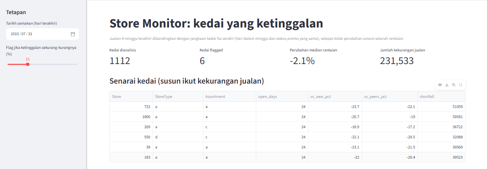
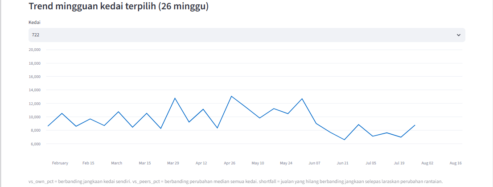

# Rossmann: promotion effect and store monitoring

Two questions on a drugstore chain's daily sales: did promotions raise sales, and which stores are falling behind their own expected level? Built as a stand-in for a healthcare distributor's "track what works" and "catch problems early" work.

## Data
[Rossmann Store Sales](https://www.kaggle.com/c/rossmann-store-sales) (Kaggle competition data). Accept the competition rules on Kaggle, then download `train.csv` and `store.csv` into `data/`. Raw data is not included in this repo.
1,115 stores, Jan 2013 to Jul 2015, about 1.0M store-days.

## 1. Promotion effect
- Promos run Monday to Friday only and switch on and off for the whole chain on the same dates, alternating week by week. There is no same-date control group, so a simple promo vs non-promo comparison is mixed with time effects.
- Design: each of 49 isolated promo weeks is compared with the average of the non-promo weeks immediately before and after it.
- Result: average weekday sales were 38.5% higher in promo weeks (95% CI 35.6 to 41.6, bootstrap over weeks). The estimate is stable by year (37.4% in 2013, 39.3% in 2014, 39.5% in 2015). A separate comparison of promo vs non-promo days within each store on the same weekday gave a similar +39.8%.
- Mechanism (rough): customer counts rose about 21% and sales per customer about 16% (ratio of averages, not measured per customer).
- Store type b (about +20%, 17 stores) and assortment b (about +11%, 9 stores) showed a smaller uplift. Samples are small, so this is a lead, not a conclusion.
- Dropped: an attempt to measure a post-promo dip, because its baseline rested on only two New Year weeks.

## 2. Store monitor (Streamlit)
Flags stores whose last 4 weeks of sales fall at least X% below expectation, after removing the chain-wide change. Expectation is the store's own average for the same weekday and promo status over the preceding 12 weeks. At the default 15% threshold on the last review date (2015-07-31), 6 of 1,112 stores are flagged.

### Backtest
The rule was applied at 28 historical review dates (every 28 days, 2013 to 2015). Across them, 271 store-periods were flagged. Four weeks later, 62.7% of flagged stores were still at least 15% behind their peers, versus 0.8% of unflagged stores. Flagged stores recovered only from -20.6% to -17.9% on average. The difference in the "still behind" rate was 62.1 percentage points (95% CI 48.8 to 75.9, bootstrap over review dates). The interval is wide because there are only 28 review dates and often fewer than 10 flagged stores per date.

### Verification
One flagged store (store 722) was recomputed outside SQL in pandas: 24 of 24 recent open days matched to the reference window, actual 179,695 vs expected 235,656, -23.7% vs own expectation, identical to the dashboard.

## Limitations
- With promos alternating weekly, the neighbouring non-promo weeks may themselves be affected (customers waiting for a promo or buying ahead), so the true uplift versus a world with no promotions is unknown.
- No discount or cost data: profitability cannot be assessed, only sales uplift. The next step would be a break-even calculation.
- Persistence of flags was much lower for January review dates (14% to 21%), possibly because Christmas trading distorts the reference window (hypothesis, not tested).
- About 180 stores have no data for part of Jun 2014 to Mar 2015, so those dates cover fewer stores.
- Store-periods are not independent (the same store appears on several dates).
- Only precision of the alert was measured, not recall.
- A gradual decline that starts inside the 12-week reference window is partly absorbed into the expectation, so the flag can understate a slow slide (visible for store 722, whose weekly sales began falling about eight weeks before the review date).
- Most flagged stores are store type a, which is simply the largest group (602 of 1,115 stores); this is not evidence that type a is a problem.

## Files
- `import_data.py`: loads the CSVs into a local DuckDB database
- `promo_calendar.py`, `promo_schedule.py`: show that promos are chain-wide and alternate weekly
- `uplift_detail.py`: within-store uplift, customers vs basket, by store type and assortment
- `adjacent_weeks.py`: the promo-week design above, with bootstrap CI
- `backtest_monitor.py`: backtest of the store alert rule
- `check_store.py`: independent recomputation of one store
- `app.py`: Streamlit store monitor

## Run
    pip install -r requirements.txt
    python import_data.py
    streamlit run app.py

Built with AI assistance (Claude). Results were checked by running independent comparisons and reading the outputs, not taken on trust.